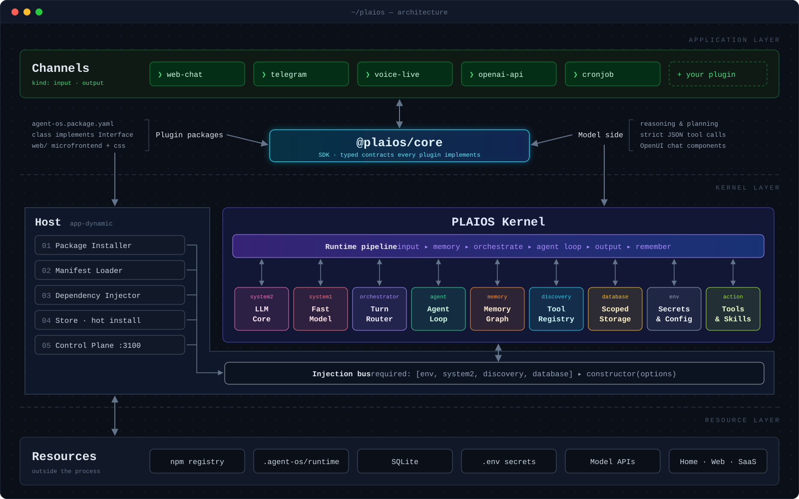

# PLAIOS

**The Pluggable AI Operating System.** Say it "PLAY-os". An operating system for AI agents, where every part is a plugin.

Most agent frameworks give you a brain and let you bolt tools onto it. PLAIOS does the opposite: there is no brain. There is a host that loads packages, hands each one the others it asked for, and gets out of the way. The model is a package. The memory is a package. The router that picks tools is a package. Telegram, the web chat, the cron scheduler, Home Assistant: all packages, all on the same contracts.

This repo is where you start. It holds the contracts, the shared UI kit, the tooling, the docs, and (as git submodules) the runtime host and every published plugin, so one `git clone --recursive` gives you the whole system.

## Why it exists

- **Swap anything.** Want a different model, memory or router? Write a class that satisfies the interface in `@plaios/core/domain` and point `plaios.yaml` at it. Nothing in the host changes.
- **Wiring is declared, not coded.** A plugin's `agent-os.package.yaml` says what it is (`kind: action`) and what it needs (`required: [env]`). The host builds its constructor options. Plugins never import each other.
- **Every part has a face.** Each interface ships a React microfrontend, so every component gets a settings page in the control plane, and capabilities can teach the model to draw live cards inside its answers.
- **Install without restarting.** Plugins are ordinary npm packages. The host installs them from a registry at runtime, from config or from the built-in Store.

## How it works

<p align="center">
  
</p>

- **Application layer.** Channels (web chat, Telegram, voice, an OpenAI-compatible API, cron) are plugins of kind `input`/`output`. Every plugin is built against the typed contracts in `core`.
- **Kernel layer.** The host (`app-dynamic`) installs packages, reads their manifests and injects what each one `required`. The runtime pipeline moves one message through `input ▸ memory ▸ orchestrate ▸ agent loop ▸ output ▸ remember`, and every slot below it is a swappable plugin.
- **Resource layer.** The npm registry plugins come from, the isolated runtime folder, SQLite, `.env` secrets, model APIs and the outside world.

Inputs never know outputs exist, the agent loop never touches memory directly: every arrow goes through a contract in `core/`. The full walkthrough is in the developer guide, chapter [One message, start to finish](developer-guide/guide/02-journey.md).

## What is in this repo

| Path | What it is |
| --- | --- |
| [`core/`](core) | `@plaios/core`: provider-neutral TypeScript contracts (input, output, capability, memory, orchestrator, agent, AI, database, env, discovery). No runtime code. |
| [`microfrontend/`](microfrontend) | `@plaios/microfrontend`: shared React contracts, config editor, theme and shadcn-style components for plugin pages. |
| [`package-manager/`](package-manager) | `@plaios/package-manager`: the `plaios` CLI: first-run setup, `plaios create`, `plaios start`. |
| [`developer-guide/`](developer-guide) | The developer guide, as markdown in [`developer-guide/guide`](developer-guide/guide) and as an installable plugin (a page in the UI plus a `read_developer_guide` tool for the agent). |
| [`app-dynamic/`](https://github.com/ChomasDev/plaios-app) | Submodule. `@plaios/app-dynamic`: the runtime host and control plane. |
| [`packages/`](https://github.com/ChomasDev/plaios-packages) | Submodule. Every plugin: Telegram, Codex, SQLite, memory graph, agent loop, orchestrators, actions. |
| [`examples/plaios.full.yaml`](examples/plaios.full.yaml) | A full reference component graph. Your own `plaios.yaml` is generated by `plaios` on first run and not committed. |

Everything is one pnpm workspace, so the submodules build against the local `core` and `microfrontend` (`workspace:*`).

## Quick start

```bash
git clone --recursive https://github.com/ChomasDev/plaios.git
cd plaios
pnpm install && pnpm build
pnpm plaios        # first run: pick the AI, channels and tools in the terminal, then it starts
```

The plugins are installed from an npm registry, so the first time you also need a local one with the plugins published. **[How to run PLAIOS](docs/how-to-run.md)** covers it step by step.

## Build your own plugin

```bash
pnpm plaios create action weather   # scaffolds packages/weather
```

Then read the [quickstart chapter](developer-guide/guide/04-quickstart.md). Chapters by topic:

- Start here: [why](developer-guide/guide/01-why.md), [one message end to end](developer-guide/guide/02-journey.md), [anatomy of a package](developer-guide/guide/03-anatomy.md), [quickstart](developer-guide/guide/04-quickstart.md)
- Components: [input](developer-guide/guide/10-input.md), [output](developer-guide/guide/11-output.md), [action](developer-guide/guide/12-action.md), [memory](developer-guide/guide/13-memory.md), [orchestrator](developer-guide/guide/14-orchestrator.md), [agent loop](developer-guide/guide/15-agent.md), [discovery](developer-guide/guide/16-discovery.md), [models](developer-guide/guide/17-models.md), [database](developer-guide/guide/18-database.md), [env](developer-guide/guide/19-env.md)
- Superpowers: [injection](developer-guide/guide/30-injection.md), [config and secrets](developer-guide/guide/31-config.md), [pages](developer-guide/guide/32-pages.md), [chat components](developer-guide/guide/33-chat-components.md), [docs for the agent](developer-guide/guide/34-ai-docs.md), [publish](developer-guide/guide/35-ship.md), [sharp edges](developer-guide/guide/36-sharp-edges.md)

## Working with the submodules

```bash
git submodule update --init --recursive        # after a plain clone
git submodule update --remote                  # pull the latest of both
```

A change inside `packages/` or `app-dynamic/` is committed and pushed in that submodule first, then the new pointer is committed here:

```bash
cd packages && git checkout main && git commit -am "..." && git push && cd ..
git add packages && git commit -m "Bump packages"
```

## Commands

| Command | What it does |
| --- | --- |
| `pnpm build` | Build every package in the workspace |
| `pnpm test` | Run every package's tests |
| `pnpm typecheck` | Type-check everything |
| `pnpm plaios create` | Scaffold a plugin into `packages/` |
| `pnpm plaios` | First run: terminal setup. Then: install the configured plugins and start the host on :3100 |
| `pnpm plaios init` | Redo the setup (AI, channels, tools, keys) |
| `pnpm landing:dev` | Run the app-dynamic landing page |
